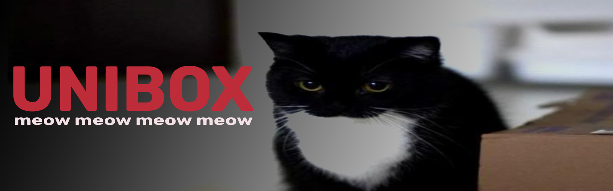

  ## 

  
  
  
  
  
  
  
   
  
  
  
  
   
  AVX2 may be faster than SSE2 though not all CPUs support it (`Steam > Help > System Information > Processor Information > AVX2`). PDBs are for developer use. 
    
  <strong>Ember builds are experimental.</strong> Some features may be broken or unstable.
    
  Binaries are built automatically on every push to master. 
    
  <!-- Textmode doesnt fully make the game textmode. You need to preload [TextModeTF2](https://github.com/pupnoodle/TextmodeTF2) module to make the game textmode. -->

  ##
  
  Read about the original Amalgam documentation and features [here](https://github.com/rei-2/Amalgam/wiki).
    
  Note: This is <strong>GatoPotato658's fork</strong> with additional features and changes over the original rei-2 version.

##

### 
Changes in this version

- **General**
  - Nav engine
    - Pathfinding tool used by `Navbot` and such
    - Requires nav meshes (`.nav` files placed in `tf\maps` folder. `Unibox\Nav` is only used for saving already loaded nav mesh via `cat_save_nav_mesh` command)
       **IMPORTANT:** Nav meshes generated by the in-game command `nav_generate` can and will confuse the nav engine in certain situations (often connecting nodes far away from eachother and creating impossible paths). Therefore such nav meshes require manual edit.
  - Navbot
    - Utilizes `Nav engine` to complete goals specified by navbot preferences
    - Also includes misc features: `Auto scope`, `Force weapon` and `Recharge DT`
  - Followbot
    - Automatically follows specified targets
    - Utilizes `Nav engine` if specified
    - Options for follow/activation/abandon distances, target preference and priority, max path nodes, view snap avoidance and path drawing
  - Navbot options: personality, smart jump, escape spawn, melee target range, blacklist scan delays, danger overlay
  - Nav engine options: stuck detection/blacklist/expire times, vischeck, path in setup time, look at path (with speed)
  - Navbot jobs: capture objectives, engineer, escape danger, get supplies, MvM sniper, roam, stay near; plus hazard avoidance
  - Per-bot route and lane variation
  - Namedpipe
    - Implements communication with [unibox botpanel](https://github.com/pupnoodle/unibox-botbox)
    - Sends client info such as localplayer's health, class, server name and map name
  <!--
  - Textmode builds ([TextModeTF2](https://github.com/pupnoodle/TextmodeTF2) compatibility)
    - Disables game visuals to decrease CPU usage
    - Enables `Namedpipe`
    - Enables some additional hooks to avoid crashes (currently WIP)
  -->
- **Misc**
  - Radio: listen to music while playing
  - Backtrack to crosshair (Performs `tick_count` manipulations on manual shots allowing to hit backtrack records)
  - Auto engineer building repair/upgrade
  - Auto class select
  - Auto disguise (disguises as a random class if not disguised already)
  - Auto edgebug (Nullifiews fall damage by landing on an edge of a surface. Can strafe automatically if specified)
  - Telemetry blocker (Off/Lite/Balanced/Aggressive; disables stats tracking, Steamworks session ids, replay and matchmaking OGS reporting convars, restored on unload)
  - Auto vote (tracks pending votes and handles votekicks automatically, with random vote delay and auto vote map)
  - Auto retry (below a health threshold), auto taunt on kill (chance and slot), auto report players
  - Random class (interval and exclusion list) and autojoin class
  - Kill say and chat spam extras (team chat, randomize, auto reply, vote kick reply)
  - Micspam, noise spam and callvote spam
  - Anti-aim: anti-overlap and taunt spin
  - Auto queue extras: auto casual join, auto competitive queue, BootCamp queue, only uncompleted MannUp missions, auto abandon if no navmesh, queue delay, profile stalker, auto dump profiles
  - MvM extras: auto abandon Mann Up, Buybot auto class, chat commands (allowed users/tag)
  - Skin changer (warpaint paint kit, unsupported warpaints, australium, festive, killstreak, sheen, weapon unusual effects)
  - Anti-autobalance option to try avoiding an autobalance on death if enemy team has more than 2 missing players
  - Changes to auto queue allowing for more customization:
    - Search community servers
    - Auto re-queue (if kicked, players less/greater than <...>)
    - MannUp queue
  - Cathook's autoitem system (Automatically equip weapons, hats, noisemakers. Currently glitchy on textmode builds)
  - `-insecure` bypass (Bypasses client-side checks allowing to join VAC protected servers.)
  - Added weapon shooting sound break exploit (Switches weapons back and forth every attack avoiding shoot sound. Soldier only)
  - MvM:
    - Buybot: Performs MVM upgrade station exploit which can result in huge amounts of cash (You have to be playing medic with a vaccinator and walk to the upgrade station while the `Buybot` automatically buys and refunds an upgrade giving you additional cash). Stops at a specified cash count.
    - Auto ready up
  - Ping reducer now uses target ping value instead of `cl_cmdrate`
  - Added option for auto detonation to wait for sufficient damage before detonating (Not recommended to use it as it's far from being perfect)
  - Aimbot:
    - 360 aim FOV and allow aiming with active ui
    - Smooth curve (assist strength changes dynamically depending on this option and a curve percentage var)
    - Smooth+velocity aim type (same smooth aim type but also takes into account target's velocity for smooth curve)
    - legitforbots aim type with human reaction, tracking, fire timing, and legit look at path
    - Separate target selection for hitscan, projectile and melee
    - Grappling hook aim
    - Auto short circuit minimum metal amount
    - Auto heal: auto switch at health, activate friends only, activate at health percent
  - Spam features:
    - Voice command spam
    - Chat spam
    - Voice chat spam
    - Achievement spam
    - Vote spam
  - New commands (all commands now use `cat_` prefix):
    - `cat_criteria`: Loads casual criteria
    - `cat_abandon`: Abandons current match
    - `cat_load`: Loads specified config
    - `cat_path_to`: Walks to given xyz coordinates using `Nav engine`
    - `cat_cancel_path`: Cancels current path and job
    - `cat_save_nav_mesh`: Saves currenly loaded nav mesh into the `.nav` file located at `Unibox\Nav`
    - `cat_ignore`: Adds/Removes specified tag for given steamid32
    - `cat_dump`: Dumps names + avatars for players present on the currently connected server
    - `cat_rent_item`: Automatically rents an item with given item definition index
    - `cat_achievement_unlock`: Unlocks item only or all in-game achievements depending on the given argument
    - `cat_achievement_unlock_item`: Unlocks item achievements
    - `cat_achievement_unlock_weapon`: Same as `cat_achievement_unlock_item`
    - `cat_achievement_lock`: Locks achievements
    - `cat_achievement_lock_item`: Locks item achievements
    - `cat_achievement_lock_weapon`: Same as `cat_achievement_lock_item`
- **Visual**
  - ImGui-rendered ESP (boxes: solid/outline/rounded/corner, bars, etc.) instead of the engine-painted (`vgui`/surface) ESP
  - ImGui-based UI elements: menu, notifications, indicator panels, spectator list, ticks/crithack indicators
  - Anti-OBS: draws the ImGui overlay in a separate layered, click-through window excluded from screen capture (`WDA_EXCLUDEFROMCAPTURE`), so OBS/Discord/screenshots don't see the cheat visuals
  - Added option to turn on weapon killstreak count
  - Added option to reverse invisible condition in groups (`Invisible -> Not invisible`)
  - Esp, glow and chams:
    - Min and max draw/render distance
    - Distance to alpha (Transparency changes depending on current distance and minmax values of render distance)
  - Crithack, Ticks and Spectator List indicator changes
  - Show triggers (hurt, ignite, push, regenerate, respawn room, capture area, catapult, apply impulse) with separate colors, trigger angle and surface center
  - Best path and best aim pos drawing
  - Auto zombie thirdperson
  - Nav engine:
    - Indicator: Shows info about `Navbot`'s current goal
    - Draw: Renders path, blacklisted nodes and local area
  - Weather effects 
- **Other**
  - Added debug var automatic loading (`Load debug settings` in menu)
  - Changed loading process allowing for early injection (e.g. Xenos manual launch)
  - Added signature generator for crash log call trace
